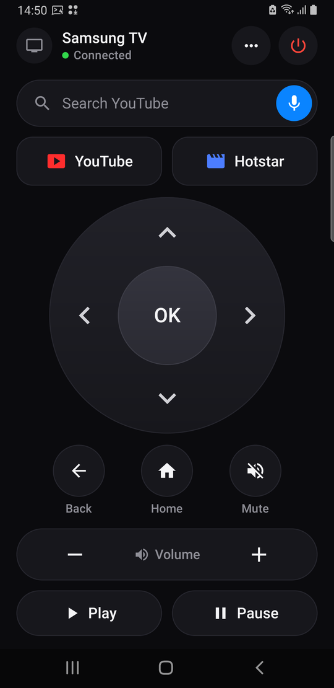
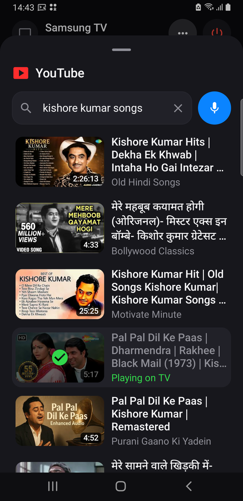
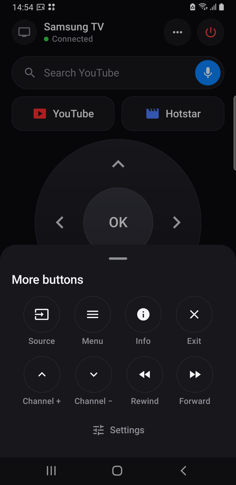

# Samsung TV Remote

A simple, phone-based remote for Samsung Tizen smart TVs, built so that anyone (including
parents who just want to watch something) can use it without hunting through menus.

<p>
  
  
  
</p>

## Features

- **Search YouTube on the phone, play on the TV.** Type or speak, pick a video from the results,
  and it starts on the TV - no on-screen letter grid. Works with
  [TizenTube](https://github.com/reisxd/TizenTube) (ad-free YouTube via TizenBrew).
- **Voice search** through the phone's speech recognition.
- **Full remote**: D-pad with OK, Back, Home, Mute, Volume, Play/Pause, plus Source, Menu, Info,
  Exit, Channel, Rewind and Forward in a "More" sheet. Arrows, volume and channel repeat while held.
- **Phone volume buttons** control the TV volume while the app is open.
- **Now playing**: see what YouTube is playing on the TV, pause it and seek from the phone.
- **Favourites and recent searches**, plus *Play next* / *Add to queue* on any result.
- **Volume level** shown as a number (read from the TV).
- **Works with the app closed**: buttons in the notification bar, a Quick Settings tile and a
  home-screen widget.
- **Finds the TV automatically** on Wi-Fi (no IP address needed), with manual entry as a fallback.
- **Power** off over the network. Power on uses Wake-on-LAN (needs *Power On with Mobile* on the
  TV; not yet verified over Wi-Fi standby).
- **App shortcuts** for YouTube (TizenBrew) and Hotstar.
- Large labelled buttons, dark calm design, no vibration.

Tested on a 2022 Samsung UA75BU8000 (Tizen 6.5) with a Galaxy S9+ (Android 10).

## Install

Download the APK from [Releases](../../releases) and install it, or build it yourself:

```bash
cd android
./gradlew assembleRelease
adb install -r app/build/outputs/apk/release/app-release.apk
```

## First-time setup

1. Phone and TV on the same Wi-Fi. Open the app; it finds the TV by itself.
2. The TV asks to **Allow** the new remote - accept with the normal remote (one time).
3. For YouTube search: tap **Search YouTube**, then on the TV open YouTube →
   **Settings → Link with TV code** and type the 12 numbers into the app. This is done once per
   phone (for example by whoever sets the phone up); the link is kept from then on.

If YouTube isn't open on the TV when a video is picked, the app tries to start TizenBrew, enter
TizenTube from its module list (Down, then OK) and play the video. This is **not reliable yet**:
TizenBrew restarts itself while opening, and its autolaunch setting only sometimes takes
effect, so the key presses can miss. If YouTube was fully closed, open it once with the normal
remote; after that, picking videos on the phone works every time.

## How it works

Everything is local network traffic to the TV, except YouTube search and playback, which go
through YouTube's own servers exactly like the official YouTube phone app.

| Feature | Mechanism |
|---|---|
| Buttons | WebSocket `wss://TV:8002/api/v2/channels/samsung.remote.control` sending `ms.remote.control` key events. First connection shows an Allow prompt; the returned token is stored and reused. |
| TV certificate | Self-signed on port 8002; the app pins it on first use and rejects changes. |
| Open apps | `POST http://TV:8001/api/v2/applications/<appId>` (the WebSocket `ed.apps.launch` event is ignored by recent firmware). |
| Discovery | SSDP search for the DIAL service, confirmed through `http://TV:8001/api/v2/`. |
| Power on | Wake-on-LAN to the TV's Wi-Fi MAC (enable *Power On with Mobile* on the TV). |
| YouTube search | YouTube's InnerTube search API (what youtube.com uses), no API key. |
| Play on TV | YouTube "lounge" API - the *Link with TV code* channel - sending `setPlaylist`. Ported from [pyytlounge](https://github.com/FabioGNR/pyytlounge) (MIT). |

Why not type into the TV's search box? YouTube on the TV uses its own letter grid instead of the
TV keyboard, so text sent to the TV's keyboard never reaches it. Searching on the phone and
sending the chosen video avoids the grid entirely.

## Laptop remote (for testing)

`tvremote.py` is a small Python client for the same protocol (early prototype, lightly tested):

```bash
pip install websocket-client
TV_IP=192.168.1.50 python3 tvremote.py pair    # accept the prompt on the TV
TV_IP=192.168.1.50 python3 tvremote.py         # interactive: arrows, enter, backspace=back, h=home, +/-=volume
TV_IP=192.168.1.50 python3 tvremote.py key KEY_VOLUP
```

## Limitations

- **Same Wi-Fi.** The phone and the TV must be on the same home network for every button. Mobile
  data or another Wi-Fi won't reach the TV.
- **First connection needs the real remote.** The TV asks once to *Allow* each new phone.
- **YouTube search needs internet** and the one-time *Link with TV code*. It only works with the
  YouTube app on the TV (TizenTube or the stock app), not other apps. Results come from YouTube's
  unofficial web API, which YouTube can change; if search breaks, an app update is needed.
- **Typing into other TV apps isn't supported.** Most TV apps (YouTube, Hotstar) use their own
  on-screen letter grids, which a remote's text input can't reach.
- **Turning the TV on** from the phone needs *Power On with Mobile* and may not work from deep
  standby over Wi-Fi. Turning it off always works.
- **Volume** follows the TV's speakers; it may not reflect a soundbar connected over HDMI ARC.
- **Notification bar buttons** can be swiped away on Android 14+; turn them back on in Settings.
- **Starting YouTube from a fully closed TizenBrew** is unreliable (see First-time setup).
- **Firmware updates** on the TV can change these interfaces. Tested on one TV and firmware only.
- **Disabling Samsung components** such as `com.samsung.tv.remoteapp*` or
  `com.samsung.tizen.smartthings-thing` (e.g. while debloating) breaks the remote API.

## Battery

Nothing runs in the background. The connection to the TV is open only while the app is on
screen; widget, notification and tile buttons connect for a moment, send one key and
disconnect. When the TV is off, reconnect attempts back off from 3 s to once a minute, and
"now playing" stops as soon as the app leaves the screen.

## Debloating tip

If you remove Samsung bloat from the TV, keep `com.samsung.tv.remoteapp*` and
`com.samsung.tizen.smartthings-thing` enabled - they provide the network remote API this app uses.

## License

MIT
